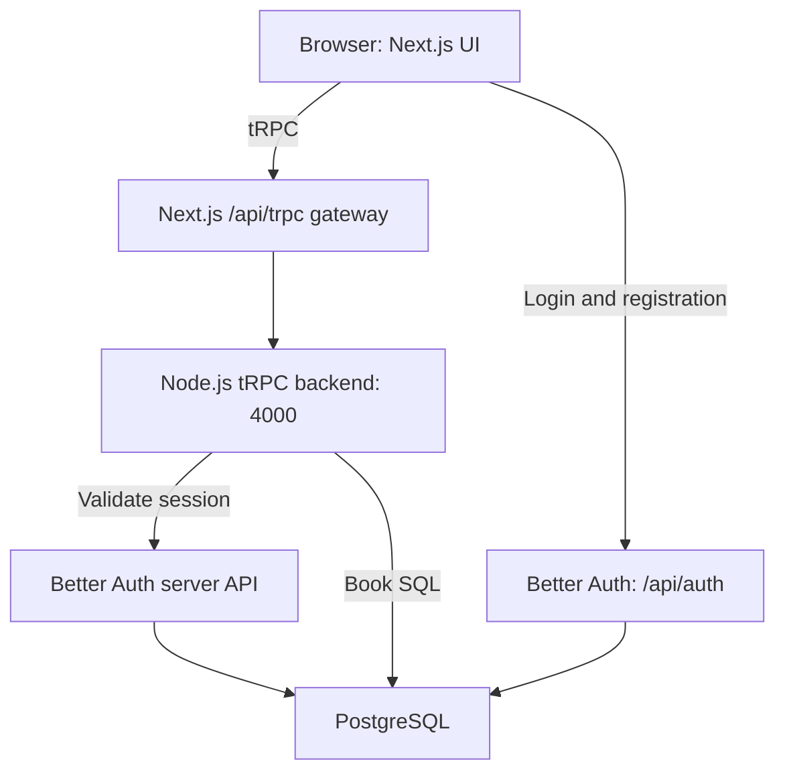

# Bookshelf — full-stack school project

A personal reading tracker built with **Next.js, TypeScript, tRPC, Better Auth, and PostgreSQL**. Includes real email/password authentication and a separate Node.js backend. Books are stored in the database, not in localStorage.

## Features

- Register, sign in, stay signed in, and sign out.
- Add, edit, and delete books; track Want to read / Reading / Finished.
- Search and filter your private collection.
- Responsive desktop/mobile interface with loading, empty, success, and error states.
- Server-side validation and per-user authorization.

## Requirements

Node.js 22+ with npm; Docker Desktop with Compose (running); internet for the initial install. Ports 3000, 4000, and 5432 must be available. No paid service or email provider is required.

## Quick start

Extract the ZIP, open the `bookshelf` folder in VS Code, and open a terminal in that folder (where `package.json` lives). Run these commands in order; they work in PowerShell, Bash, and Terminal:

```sh
npm ci
npm run setup
npm run db:up
npm run db:migrate
npm run dev
```

Open **http://localhost:3000**. Choose **Create an account** and register with your own details. There is no preloaded account. Use a password with at least eight characters. Use `localhost` in the browser, matching the configured authentication URL.

On the first migration, Better Auth may report missing tables before the script creates them. The final message should be `Authentication tables and books table are ready.`

`setup` creates `.env` with a random authentication secret, preserving existing settings. `db:up` waits for PostgreSQL to be healthy. `db:migrate` creates authentication and book tables. `dev` starts BOTH the Next.js frontend and the tRPC backend. The first page load may take a few seconds to compile.

To stop: press Ctrl+C, then run `npm run db:down`. The Docker volume preserves books and accounts. Start again with `npm run db:up` and `npm run dev`.

### Already have PostgreSQL?

Skip `db:up`. Create an empty database and update `DATABASE_URL` in `.env`, then run `db:migrate`. The database user needs permission to create tables. Auth and books use the same database.

### Optimized build

After database setup:

```sh
npm run build
npm start
```

Keep dev dependencies installed: the standalone backend runs TypeScript with `tsx`. Docker packages the database only.

## Architecture



Next.js serves the UI and authentication on port 3000. A same-origin gateway forwards tRPC requests to the separate backend on port 4000, avoiding permissive CORS configuration. The backend checks the session cookie with Better Auth before each book operation.

The client imports only the router's TypeScript type; server code and secrets do not enter the browser bundle. Calls such as `trpc.books.create.mutate(...)` infer input and output types from the backend. Zod also checks inputs at runtime.

## Files to understand

| File                                 | Role                                    |
| ------------------------------------ | --------------------------------------- |
| `src/components/bookshelf.tsx`       | Authentication forms and book interface |
| `src/app/globals.css`                | Responsive styling                      |
| `src/lib/auth.ts`                    | Better Auth with PostgreSQL             |
| `src/lib/auth-client.ts`             | Browser auth client                     |
| `src/lib/trpc-client.ts`             | Typed tRPC client                       |
| `src/lib/books.ts`                   | Shared types and Zod validation         |
| `src/lib/db.ts`                      | PostgreSQL pool                         |
| `src/app/api/auth/[...all]/route.ts` | Auth endpoints                          |
| `src/app/api/trpc/[trpc]/route.ts`   | Gateway to the backend                  |
| `server/index.ts`                    | Standalone tRPC HTTP server             |
| `server/context.ts`                  | Session validation                      |
| `server/router.ts`                   | Protected procedures and SQL            |
| `scripts/migrate.ts`                 | Database setup                          |
| `compose.yaml`                       | PostgreSQL with a persistent volume     |
| `tests/`                             | Validation and integration checks       |

## Database design

Better Auth manages `user`, `session`, `account`, and `verification`. Passwords are hashed by Better Auth; the app never stores plaintext passwords.

| Books column | Type                          | Purpose                          |
| ------------ | ----------------------------- | -------------------------------- |
| `id`         | UUID primary key              | Book identifier                  |
| `user_id`    | Text foreign key to `user.id` | Owner                            |
| `title`      | VARCHAR(160)                  | Book title                       |
| `author`     | VARCHAR(100)                  | Author                           |
| `status`     | Text with CHECK constraint    | `to-read`, `reading`, `finished` |
| `created_at` | TIMESTAMPTZ                   | Creation time                    |

One user owns many books. The owner comes from the session, never from a submitted user ID. UPDATE and DELETE match both book ID and owner ID. Deleting a user cascades to their books. SQL uses bound parameters rather than interpolating user input.

## Demonstration

1. Register and add `Things Fall Apart` by `Chinua Achebe` as `Reading`.
2. Refresh to demonstrate database persistence.
3. Edit it to `Finished`, then try search and filters.
4. Register another account in an incognito window: its shelf starts empty.
5. Delete the book from the original account and sign out.

To inspect the database:

```sh
docker compose exec db psql -U bookshelf -d bookshelf
```

```sql
\dt
SELECT id, title, author, status, user_id FROM books;
SELECT id, name, email FROM "user";
```

Enter `\q` to exit. Do not show password hashes or session tokens in a presentation.

## Checks

```sh
npm run typecheck
npm test
npm run build
```

With the database AND both servers running, open another terminal:

```sh
npm run test:integration
```

This creates two temporary accounts and checks authentication, CRUD, persistence, ownership, origin checks, and logout. It removes only its own temporary accounts afterwards. See `VERIFICATION.md` for checks performed while preparing this ZIP.

## Troubleshooting

- **Docker cannot connect:** start Docker Desktop and wait for its engine.
- **Port 5432 is occupied:** use the existing PostgreSQL database, or change the left-hand port in `compose.yaml` and `DATABASE_URL` together.
- **Database/auth error:** check `.env`, run `db:up` and `db:migrate`, then restart.
- **Book service unavailable:** use `npm run dev` to run both processes. Alternatively, use `dev:web` and `dev:api` in separate terminals. `API_PORT` and `API_URL` must match.
- **Origin error:** open the exact `BETTER_AUTH_URL`. Update this setting and restart both processes if changing the web port.
- **Setup says the file exists:** edit `.env` yourself; the setup script preserves your settings.

## Scope

A local academic demonstration. Email verification, reset-password delivery, admin roles, cover uploads, pagination, and public deployment are outside its scope. Before public hosting, configure HTTPS, deployment-specific networking, proper database credentials, and monitoring. The sample database password and loopback-only backend are for local development.

Your friend should study, customize, and be able to explain the code in line with their school's submission rules.

## Official references

- [Next.js setup](https://nextjs.org/docs/app/getting-started/installation)
- [Better Auth Next.js integration](https://better-auth.com/docs/integrations/next)
- [Better Auth database setup](https://better-auth.com/docs/concepts/database)
- [tRPC standalone backend](https://trpc.io/docs/server/adapters/standalone)
- [tRPC client setup](https://trpc.io/docs/client/vanilla/setup)
